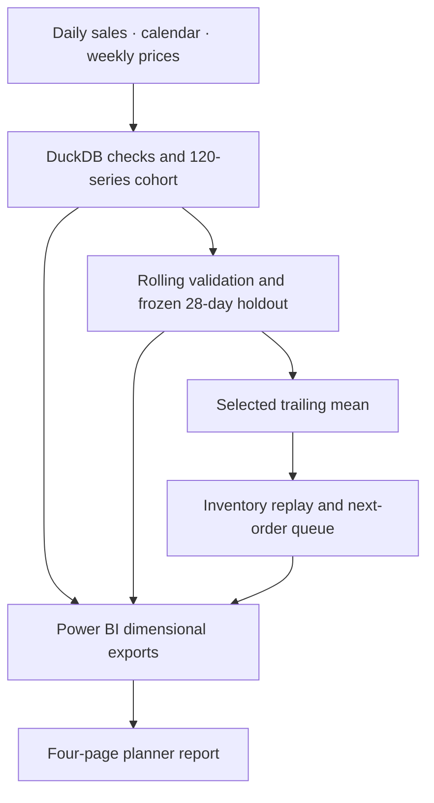

# RetailSense interview walkthrough

## The question a planner needs answered

Which item-store pairs should a planner replenish at the next review, and how much extra inventory would improve service under plausible lead times? M5 records sales. A retailer would also need on-hand balances, inbound orders and supplier delivery history before acting on these recommendations.



## Three-minute demonstration

| Time | Open this page | Show and explain |
|---|---|---|
| 0:00–0:35 | Sales and Assortment | Show both stores and the 216,614 units in the cohort. The grain is one item at one store on one day. Weekly prices join by store, item and retail week. A missing price remains unknown. |
| 0:35–1:25 | Forecast Performance | Compare all three models on the same 28-day horizon. Three earlier windows selected the trailing mean. On the untouched holdout its WAPE was 94.77%, ahead of Poisson at 95.29% and weekly naive at 106.30%. The small lead and high absolute errors limit confidence in individual order quantities. |
| 1:25–2:10 | Inventory Scenarios | At seven-day lead time, compare zero and three buffer days. Simulated fill rate rose from 71.35% to 78.42%. Average closing stock across the cohort rose from 735.61 to 1,073.21 units. Ask the planner what additional stock they can carry for that service improvement. |
| 2:10–3:00 | Replenishment Queue | Select one scenario and a store-item pair. Read the target, on-hand and inbound quantities. Suggested units equal the positive shortfall after crediting both on-hand and inbound stock. Explain why ignoring inbound stock would order the same units twice. |

For a reproducible queue example, select `forecast_cover_L7_B3`, store `TX_1` and item `FOODS_3_444`. On review day 1942 the simulated target was 234 units, with 99 on hand and zero inbound. The suggested order was **135 units**, due on day 1949 under the assumed lead time.

## Verification record

Harish confirmed the Phase 6 Desktop checks. Separately, the Phase 7 rerun used source files from GitHub commit `03229f0`, a fresh directory, an isolated Windows Python 3.12.10 runtime and the existing local M5 inputs. All 11 locked package versions matched, pip reported healthy dependencies and all nine tests passed. The run regenerated the 120-series cohort, model comparison, six inventory scenarios, nine dimensional tables and the Desktop project. The documented Windows venv launcher was not exercised in this run.

## Questions to practise

**How did you prevent leakage?** Cohort selection used sales through day 1829. Each origin used only available history. The model choice used validation windows ending before the holdout, and a test perturbs future sales to check forecast independence.

**Why can WAPE exceed 100%?** Its numerator adds absolute errors across item-days. A weekly naive WAPE of 106.30% means those errors summed to more than the units actually sold. It does not mean the model missed every sale.

**Why separate sales, forecasts and simulation into different fact tables?** Sales occur once per item-store-day. Forecasts repeat across origins and models. Simulated stock repeats across scenarios. Combining the rows directly would multiply historical sales. Shared date, store and product dimensions let a planner filter compatible measures.

**Which assumption matters most?** Sales are used as a demand proxy. Customers who left during a historical stockout are invisible. Supplier lead times, starting stock and cost weights are assumed. A production pilot would reconcile physical stock and receipts before estimating lost sales or monetary savings.

## Rebuild from a fresh checkout

Use a new checkout and Python 3.12 on Windows. Place the three M5 inputs listed in the README under `data/raw/m5`, including the evaluation sales file with days through 1941. From the repository root run:

```powershell
py -3.12 -m venv .venv
$python = ".\.venv\Scripts\python.exe"
& $python -m pip install -r requirements-lock.txt
& $python -m pip check
& $python -m unittest discover -s tests -v
& $python prepare_m5.py --raw data/raw/m5 --output outputs/m5-cohort
& $python forecast.py --cohort outputs/m5-cohort --output outputs/forecast
& $python inventory.py
& $python powerbi_export.py
& $python powerbi/build_report.py
```

Stop if a command reports an error. Compare `outputs/forecast/summary.csv` with the model table in the README and `outputs/inventory/scenarios.csv` with the inventory table. Follow the [Desktop checks](powerbi/PHASE6.md) for the final refresh and visual reconciliation.
